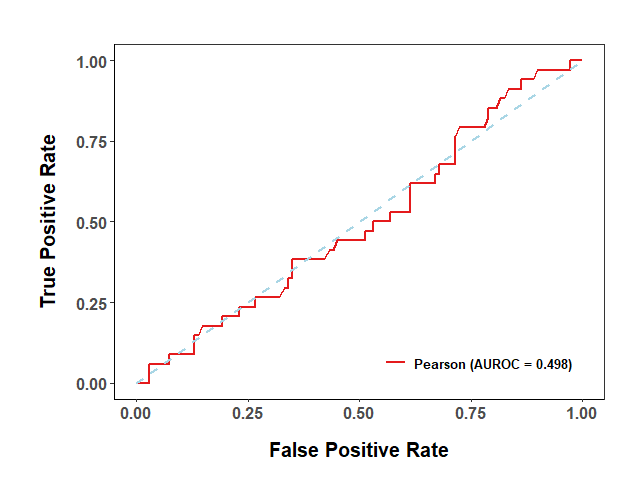
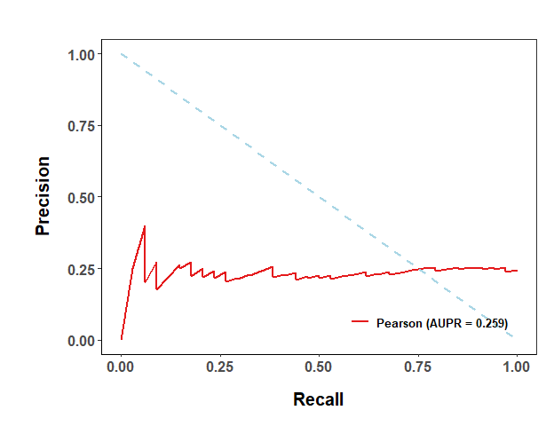
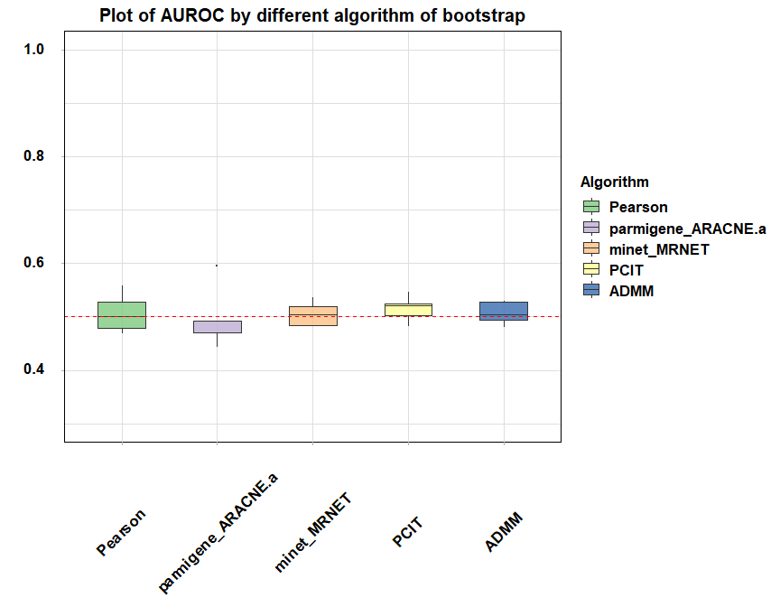

# GRNIToolS
Gene Regulatory Network Tools Selector. GRNIToolS has three parts: the R package in this directory, the deep-learning package in GRNIToolS_DL, and the single-cell foundation-model package in GRNIToolS_scFM. The following introduces the R package; the other two are documented in their own READMEs.

# Introduction

In this work, we present a comprehensive open source R package of Gene Regulatory Network Inference Tools Selector (GRNIToolS) with benchmarking real biological data from high-throughput Omics experiments to compare and assess the performance of various algorithms on gene regulatory network inference. This package contains several inference algorithms covering models of Mutual Information, Correlation, Machine learning and Meta algorithms, and includes microarray and single-cell RNA-seq data of mouse embryonic stem cells. This package provides modules that take gold standards and algorithms as input, which is helpful for the rigorous and scalable evaluation of GRN construction methods under the specific data.

# Installation

GRNIToolS is not on CRAN, and five of the packages it imports are not on CRAN
either. Install those first, then install GRNIToolS from GitHub.

### 1. Dependencies that are not on CRAN

| Package | Needed for | Where to get it |
| --- | --- | --- |
| `graph` | `GeneNet` | Bioconductor |
| `GENIE3` | `GENIE3.ET`, `GENIE3.RF` | Bioconductor |
| `minet` | `minet_ARACNE`, `minet_MRNET`, ... | Bioconductor |
| `foba` | `FoBa` | CRAN Archive (archived) |
| `PCIT` | `PCIT` | CRAN Archive (archived, and no longer on Bioconductor either) |
| `ennet` | `ENNET` | GitHub, optional (listed in `Suggests`) |

```r
install.packages("BiocManager")
BiocManager::install(c("graph", "GENIE3", "minet"))

install.packages("remotes")
remotes::install_url("https://cran.r-project.org/src/contrib/Archive/foba/foba_0.1.tar.gz")
remotes::install_url("https://cran.r-project.org/src/contrib/Archive/PCIT/PCIT_1.5-3.tar.gz")

# optional, only needed to run the 'ENNET' algorithm
remotes::install_github("slawekj/ennet")
```

`graph` contains C code, so installing it from source needs a compiler
toolchain (Rtools on Windows, Xcode Command Line Tools on macOS,
`build-essential` on Linux). If no compiler is available, install the
prebuilt `bioconductor-graph` from conda instead.

### 2. Install GRNIToolS

The R package is contained in the `GRNIToolS/GRNIToolS/` subdirectory of the
repository, so that subdirectory has to be passed explicitly:

```r
remotes::install_github("QinJingLab/GRNIToolS", subdir = "GRNIToolS/GRNIToolS")
```

`devtools::install_github()` takes the same arguments, and
`devtools::install_url()` works wherever `remotes::install_url()` is used
above. The remaining dependencies (`WGCNA`, `parmigene`, `bc3net`, `c3net`,
`Hmisc`, `igraph`, `networkD3`, ...) are on CRAN and are resolved
automatically.


# Usage for GRNIToolS

## Preparing data

All data is available at https://doi.org/10.5281/zenodo.18503006. It can also be loaded through `data()`:
```r
library(GRNIToolS) 
data("datalist")
```

Expression matrix B and gene list need to be prepared. A random set of data is generated to demonstrate how to use this package.

```r
library(GRNIToolS)
ntf <- 30
ngene <- 100
nsample <- 10
set.seed(123)
A <- matrix(rnorm(ntf * nsample,0,1),ntf,nsample)
TF <- paste0('G',1:ntf)
B <- matrix(rnorm(ngene * nsample,0,1),ngene,nsample)
X <- matrix(0,ngene,ntf)
s <- c(1:10)
gene <- paste0('G',1:ngene)
HGSmat <- matrix(0,ngene,ntf)
HGSmat[sample(ngene * ntf,0.2 * ngene * ntf)] <- 1
colnames(HGSmat) <- TF
rownames(HGSmat) <- gene
```

## Network inference

Select the network inference method. If the regression method is selected, additional matrix A and matrix X need to be provided; other methods do not need this data.

```r
res <- demo_reg(A, B, s, X, 'ADMM',max.steps = 200,TF, gene, cl.cores = 2,file=NULL,verbose=TRUE)
## The 1 -th sparsity is finished.
## The 2 -th sparsity is finished.
## The 3 -th sparsity is finished.
## The 4 -th sparsity is finished.
## The 5 -th sparsity is finished.
## The 6 -th sparsity is finished.
## The 7 -th sparsity is finished.
## The 8 -th sparsity is finished.
## The 9 -th sparsity is finished.
## The 10 -th sparsity is finished.
## [1] "ADMM has completed"
grn <- res$grn 
grn[1:5,1:5]
##               G1           G2           G3           G4           G5
## G1  0.0009354563 0.0000000000  0.000000000  0.000000000  0.004888166
## G2 -0.0009975757 0.0000000000  0.000000000  0.000000000  0.000000000
## G3  0.0133100594 0.0000000000  0.000000000 -0.001281988 -0.016885222
## G4 -0.0012174207 0.0000000000 -0.005627959  0.000000000 -0.042807730
## G5 -0.0002346995 0.0002038746  0.000000000  0.000000000  0.028707563
res <- demo_other(B,'Pearson',TF=TF,gene=gene,file=NULL,verbose=TRUE)
## [1] "Pearson has completed"
grn <- res$grn 
grn[1:5,1:5]
##           G1        G2 G3 G4 G5
## G1 0.0000000 0.7148843  0  0  0
## G2 0.7148843 0.0000000  0  0  0
## G3 0.0000000 0.0000000  0  0  0
## G4 0.0000000 0.0000000  0  0  0
## G5 0.0000000 0.0000000  0  0  0
```

## Evaluation

Calculate evaluation parameters FP, FN, Precision, Recall, F1-score, AUROC and AUPR.

```r
dat <- calpl(HGSmat = HGSmat,grn = grn,sym = F)
confu <- confusion(dat = dat,threshold = 0.5)
print(confu)
## Precision    Recall  F1-score        TP        FP        FN 
##    0.2378    1.0000    0.3842   34.0000  109.0000    0.0000
auc <- calauc(dat = dat)
print(auc)
##   AUROC    AUPR 
## 0.49798 0.25904
```

## ROC and PR curve

```r
p1 <- draw_plot(dat,method = 'ROC',algname = 'Pearson')
p2 <- draw_plot(dat,method = 'PR',algname = 'Pearson')
print(p1)
```

<p align="center">

</p>

```r
print(p2)
```

<p align="center">

</p>

## Network diagram

Generate a visual network diagram and generate a data format that can be used for Cytoscape to establish the network.

```r
net <- plot_network(grn,TF = TF,gene = gene)
#print(net)
grn <- out_grn(grn,TF = TF,gene = gene)
head(grn)
##     TF Gene     Weight
## 53  G9  G92 -0.8970992
## 48  G9  G13 -0.8969077
## 71 G13   G9 -0.8969077
## 44  G7  G97  0.8825489
## 57 G10  G59 -0.8575120
## 8   G1  G92  0.8438612
```

# The pipeline for GRNIToolS to evaluate these methods

```r
algorithm <- c('Pearson','parmigene_ARACNE.a','minet_MRNET','PCIT','ADMM')
conlist <- grn_main(A=A,B=B,X=X,seq = s,gene=gene,TF=TF,algorithm = algorithm,
                    HGSmat = HGSmat,file=TRUE, verbose=FALSE,bootstrap_num = 5,sym = FALSE,threshold = 0.5)
print(conlist[1:10,])
##             Algorithm Precision Recall F1-score  TP  FP FN   AUROC    AUPR
## 1             Pearson    0.2369      1   0.3831 104 335  0 0.46803 0.23573
## 2             Pearson    0.2064      1   0.3422 103 396  0 0.55883 0.28864
## 3             Pearson    0.1980      1   0.3305 156 632  0 0.50039 0.20292
## 4             Pearson    0.2041      1   0.3390 120 468  0 0.47851 0.19544
## 5             Pearson    0.2205      1   0.3614 144 509  0 0.52730 0.25350
## 6  parmigene_ARACNE.a    0.2367      1   0.3828  58 187  0 0.47054 0.23483
## 7  parmigene_ARACNE.a    0.2391      1   0.3860  55 175  0 0.59590 0.29612
## 8  parmigene_ARACNE.a    0.1991      1   0.3321  44 177  0 0.44318 0.18344
## 9  parmigene_ARACNE.a    0.2000      1   0.3333  63 252  0 0.47011 0.20803
## 10 parmigene_ARACNE.a    0.1784      1   0.3028  38 175  0 0.49195 0.18865
##          Time
## 1  0.16796899
## 2  0.01796699
## 3  0.04223704
## 4  0.01999903
## 5  0.02099895
## 6  0.03596711
## 7  0.02999902
## 8  0.02899909
## 9  0.03196979
## 10 0.03299880
dat <- data.frame(alg = conlist$Algorithm,auc = conlist$AUROC)
p <- draw_box(dat,'AUROC')
```

<p align="center">

</p>

# Contact


* **Yongqiang Zhou**, School of Pharmaceutical Sciences, Sun Yat-sen University. 

   **Email**: zhouyq67@mail2.sysu.edu.cn

* **Jing Qin**, School of Pharmaceutical Sciences, Sun Yat-sen University. 
   
   **Email**: qinj29@mail.sysu.edu.cn
---