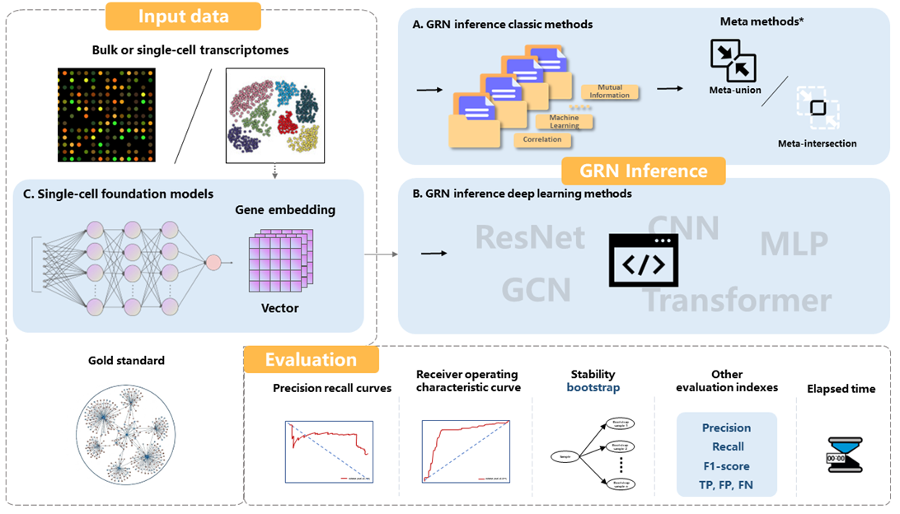

# GRNIToolS: Gene Regulatory Network Tools Selector

GRNIToolS provides an efficient and reproducible evaluation pipeline for Gene Regulatory
Network (GRN) inference. By integrating a wide array of inference methods into a suite of
user-friendly tools, it accommodates different algorithm categories and platform requirements
through three specialized modules. Every method lives in its own package, and `grn_run.py` at
the repository root gives all 50 of them a single command line without changing how any of
them works.

Repository: <https://github.com/QinJingLab/GRNIToolS>

## Contents

| Path | What it is |
|---|---|
| `GRNIToolS/` | The R package: 31 algorithms, plus `GRNIToolS_data/` with 11 datasets |
| `GRNIToolS_DL/` | 10 deep learning methods, plus `Input_data/` |
| `GRNIToolS_scFM/` | 9 methods built on single-cell foundation models |
| `gold_standard_networks/` | Reference gold-standard edge lists, separate from the labels the pipelines use |
| `grn_run.py` | Unified command line over all three packages |
| `grnitools.yaml`, `install_deps.R` | The shared conda environment and the R packages conda does not carry |

## Modules Overview

The toolkit comprises one R package for classic statistical methods and evaluation, and two
Python packages for deep learning and foundation model approaches.



*Bulk or single-cell transcriptomes feed three inference routes — classic statistical methods
(A, including the meta-union and meta-intersection ensembles), deep learning methods (B), and
single-cell foundation models whose gene embeddings become features (C). Every prediction is
then scored against a gold standard on one evaluation stack: precision–recall and ROC curves,
bootstrap stability, precision/recall/F1/TP/FP/FN, and elapsed time.*


- **`GRNIToolS/` (R 4.5.3, 31 algorithms)** — correlation, mutual information, machine learning
  and ensemble algorithms, all reached through `grn_main()`. The two meta methods combine
  several of those predictions and are called through `run_meta()`; `grn_run.py` does not
  expose them.
- **`GRNIToolS_DL/` (Python 3.10, PyTorch 2.1.2, 10 methods)** — DeepSEM, DeepDRIM, GRNCNN,
  GRNResNet, STGRNS, GRNTrans, GENELINK, GRNGCN, IGEGRNS, DeepRIG. Launched by `main.py`;
  training runs with default parameters or with Optuna hyperparameter search (`--opt`).
- **`GRNIToolS_scFM/` (Python 3.10, PyTorch 2.1.2, 9 methods)** — a classifier (`cos`, `logit`,
  `rf`, `xgb`, `MLP`, `ResNet`, `CNN`, `Transformer`, `GCN`) applied to the gene embeddings of a
  pretrained biological language model (GenePT, Gene2vec, Geneformer, GeneCompass, scBERT,
  scFoundation, scGPT, CellPLM, iSEEEK). Launched by `main.py train`.

Installation, data formats, method lists and evaluation details are documented in each
package's own README:
[`GRNIToolS/README.md`](GRNIToolS/README.md),
[`GRNIToolS_DL/README.md`](GRNIToolS_DL/README.md),
[`GRNIToolS_scFM/README.md`](GRNIToolS_scFM/README.md).

## Building the environment

All three packages share one conda environment, `grnitools`, built from the two files at the
repository root:

```bash
CONDA_CHANNEL_PRIORITY=strict conda env create -f grnitools.yaml   # R 4.5.3, compilers, conda R packages
conda activate grnitools
Rscript install_deps.R                                       # R packages conda lacks, then GRNIToolS
pip install -r GRNIToolS_DL/requirements.txt
pip install -r GRNIToolS_scFM/requirements.txt
```

## Quick start

```bash
conda activate grnitools        # required: the Python backends spawn children with a bare `python`
python grn_run.py --list        # 50 methods and which package has which dataset
```

```bash
# GRNIToolS_DL: 
python grn_run.py --method GRNGCN --dataset Ecoli --output results \
    -- --epochs 50 --batch_size 64 --lr 1e-4 --hidden 128

# GRNIToolS_scFM: 
python grn_run.py --method cos --dataset A549 --output results \
    --pt GRNIToolS_scFM/model_file/GeneCompass/GeneCompass_Base \
    -- -l GeneCompass 

# GRNIToolS (R): 
python grn_run.py --method Pearson --dataset Ecoli --output results 
```

Each run writes into `results/<method>/`; 

| Flag | Meaning |
|---|---|
| `--method` | one of the 50 names; see `--list` |
| `--dataset` | canonical dataset name, mapped onto each package's own spelling |
| `--output` | output root, default `results`; each run gets `<output>/<method>/` |
| `--list` | print methods and dataset coverage |
| `--pt` | scFM gene-embedding file |


The Optuna search is reached the same way:

```bash
python grn_run.py --method GRNGCN --dataset Ecoli --output results -- --opt --num_trials 30
```

## Docker

A `Dockerfile` at the repository root builds the whole toolkit — CUDA 12.1, torch 2.1.2, the
R and Python environments, and the datasets and model weights themselves. The host only needs
Docker and the NVIDIA container toolkit:

```bash
docker build -t grnitools:latest .
docker run -it --rm --gpus all grnitools:latest
python grn_run.py --list
```

The build takes one to two hours and needs about 100 GB of free disk: the R packages compile
from source and the resulting image is 60 GB, datasets and model weights included. On a network
where Docker Hub or PyPI is slow, point the build at a mirror with `--build-arg`; the four
settings are at the top of the `Dockerfile` and default to the upstream addresses.

To skip the build, load the prebuilt archive instead — a 19 GB download that unpacks to the
same 60 GB image:

```bash
docker load -i grnitools_image.tar.gz      
docker run -it --rm --gpus all grnitools:latest
```

## Downloading data and model weights

Large datasets, pretrained model weights and the offline Docker image are hosted on Zenodo
(DOI: [10.5281/zenodo.18503006](https://doi.org/10.5281/zenodo.18503006)):

- `GRNIToolS.zip` — code, datasets and model checkpoints for the full pipeline.
- `gold_standard_networks.zip` — the reference gold-standard edge lists.
- `grnitools_image.tar.gz` — the offline Docker image.


## Contact

* **Yongqiang Zhou**, School of Pharmaceutical Sciences, Sun Yat-sen University. 

   **Email**: zhouyq67@mail2.sysu.edu.cn

* **Jing Qin**, School of Pharmaceutical Sciences, Sun Yat-sen University. 
   
   **Email**: qinj29@mail.sysu.edu.cn
---